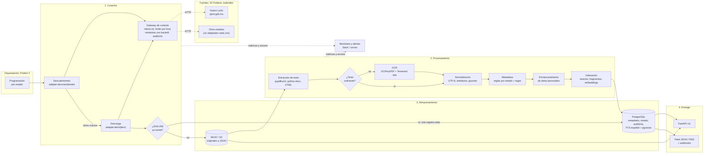
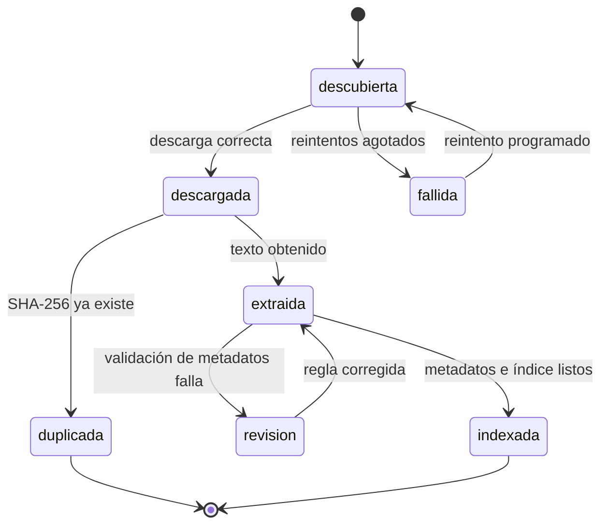

# 01 · Arquitectura del pipeline de sentencias

Este documento define la arquitectura del sistema que cosecha, procesa, indexa y publica sentencias de los 32 Poderes Judiciales estatales de México.

Es el **Bloque 1** de 5. Los siguientes bloques agregan el esquema SQL, el código, la orquestación y la estrategia de mantenimiento.

---

## 1. Punto de partida (lo que ya existe)

| Hallazgo en `webScraping/` | Consecuencia para el diseño |
| :--- | :--- |
| Solo hay código para Nuevo León (`pjenl.gob.mx`, materia penal). | Se necesita un **adaptador por estado** con un contrato común. |
| 2,900 sentencias únicas en `sentencias_with_url.csv`. | Es la semilla para la carga histórica de Nuevo León. |
| La URL real del PDF tiene un identificador de archivo: `controller.aspx?file=~\files\146198-<uuid>.pdf`. | Ese identificador sirve como **llave estable** para deduplicar antes de descargar. |
| `generador-sentencias.py` obtiene la URL del PDF con HTTP simple (`var DEFAULT_URL`), sin navegador. | La descarga puede hacerse con `httpx`; el navegador solo se usa donde sea indispensable. |
| Fechas en formato `18/marzo/2021`. | La normalización de fechas en español es parte del contrato del adaptador. |
| `Penales.aspx` no respondió en 15 s en una prueba del 2026-11-07. | Los timeouts, reintentos y horarios nocturnos son requisitos, no extras. |
| `robots.txt` de `pjenl.gob.mx` no bloquea `/SentenciasPublicas/` (revisado el 2026-11-07). | Se puede cosechar; hay que volver a revisar `robots.txt` en cada ejecución. |
| Notebooks con Selenium 3 (`find_element_by_xpath`, eliminado en Selenium 4) y rutas `C:\Users\...`. | El código nuevo vive en un paquete Python, no en notebooks. |

---

## 2. Diagrama de flujo de datos



### Ciclo de vida de una sentencia

Cada sentencia avanza por estados guardados en PostgreSQL. Así el pipeline se puede detener y reanudar sin perder trabajo.



---

## 3. Stack tecnológico

| Capa | Elección | Razón principal | Alternativa descartada |
| :--- | :--- | :--- | :--- |
| Lenguaje | **Python 3.12 + asyncio** | El equipo ya usa Python. Tiene el mejor ecosistema de PDF, OCR y NLP en español. | Node/TypeScript: dividiría el código en dos lenguajes. |
| Cliente HTTP | **httpx** (async, HTTP/2) | Permite muchas descargas concurrentes con límites por host. | `requests`: es síncrono. |
| Navegador | **Playwright**, solo si el portal lo exige | Espera automáticamente a que carguen los elementos. Ya viene instalado en el entorno. | Selenium: la API usada en los notebooks ya no existe. |
| Orquestador | **Prefect 3** | Los flujos son Python normal. Trae reintentos, límites de concurrencia, interfaz web y alertas. Puede usar el mismo PostgreSQL. | Airflow: requiere más servicios y su modelo de DAG es más rígido. Temporal: muy potente, pero difícil para un equipo estudiantil. |
| Cola de trabajo | **Tabla en PostgreSQL** con `FOR UPDATE SKIP LOCKED` | Evita operar Redis o RabbitMQ. Es transaccional con los metadatos. | Celery + Redis. |
| Base de datos | **PostgreSQL 17** | Metadatos, estados, auditoría y búsqueda en un solo sistema. | — |
| Búsqueda por palabras | **FTS de PostgreSQL** (`spanish` + `unaccent`) | Suficiente para el volumen esperado. El índice siempre coincide con los metadatos. | OpenSearch: ver la regla de migración en la sección 4.5. |
| Búsqueda semántica | **pgvector** (índice HNSW, tipo `halfvec`) | Mismo motor; `halfvec` usa la mitad de memoria. | Base vectorial separada. |
| Almacenamiento de objetos | **MinIO** en local, **S3 o GCS** en producción | Misma API S3 en todos los ambientes. | Carpetas locales u OneDrive. |
| Texto de PDF | **pypdfium2** | Rápido y con licencia permisiva (Apache/BSD). | PyMuPDF: licencia AGPL. Hay que validar si es compatible con la licencia del ITAM. |
| OCR | **OCRmyPDF + Tesseract (`spa`)** | Corrige la inclinación de la página y genera un PDF con texto buscable. | PaddleOCR: más pesado y conviene usarlo con GPU. |
| Metadatos | **Reglas regex por estado** + spaCy `es_core_news_md` (opcional) | Resultados reproducibles y auditables. | Extracción con LLM: costo variable y menos reproducible. Se puede evaluar después. |
| API | **FastAPI + Pydantic v2 + SQLAlchemy 2 (asyncpg)** | Validación estricta y documentación OpenAPI automática. | — |
| Logs | **structlog** en JSON | Todos los logs llevan `run_id`, `fuente` y `sentencia_id`. | Logs de texto libre. |

---

## 4. Decisiones de diseño

### 4.1 Un adaptador por estado

Cada estado implementa el mismo contrato. Solo cambia lo específico del portal.

```python
class SourceAdapter(Protocol):
    fuente: str                                              # "nl-penal"
    async def discover(self, desde: date) -> AsyncIterator[ListingItem]: ...
    async def fetch(self, item: ListingItem) -> RawDocument: ...
    def parse_metadata(self, texto: str, item: ListingItem) -> MetadatosParciales: ...
```

El núcleo (reintentos, límites, almacenamiento, deduplicación y auditoría) se escribe una sola vez.

### 4.2 Tres etapas separadas e idempotentes

1. **Descubrir:** leer los listados del portal y registrar `ListingItem` nuevos.
2. **Descargar:** bajar el archivo, calcular su SHA-256 y guardarlo en MinIO/S3.
3. **Procesar:** extraer el texto, los metadatos y el índice.

Cada etapa se puede volver a correr sin duplicar datos. Cambiar el extractor solo requiere reprocesar, sin volver a descargar. Por eso cada resultado guarda su `extractor_version`.

### 4.3 Deduplicación en tres niveles

| Nivel | Cuándo | Llave | Qué evita |
| :--- | :--- | :--- | :--- |
| 1 | Antes de descargar | `(fuente, source_key)`; en Nuevo León es el id de archivo `146198-<uuid>` | Descargas repetidas |
| 2 | Después de descargar | SHA-256 de los bytes | Guardar el mismo archivo dos veces |
| 3 | Después de extraer | SHA-256 del texto normalizado | Indexar la misma sentencia publicada como un PDF distinto |

Los archivos se guardan por su hash: `raw/ab/abcdef….pdf`. Si dos URLs entregan el mismo archivo, se guarda una sola copia.

### 4.4 Carga incremental

- Cada fuente guarda una **marca de agua**: la fecha de publicación más reciente que ya se procesó.
- Cada ejecución consulta desde `marca_de_agua − 7 días`. Los portales a veces publican con retraso o fuera de orden.
- La deduplicación del nivel 1 descarta lo que ya se procesó dentro de esa ventana.

### 4.5 PostgreSQL como motor de búsqueda

Un solo sistema es más fácil de operar para el equipo. Se migraría a OpenSearch si se cumple **alguna** de estas condiciones:

- La búsqueda tarda más de 500 ms en el percentil 95 con los filtros más usados.
- Hay más de 20 millones de fragmentos con embeddings.
- Se necesitan funciones que FTS no tiene, como resaltado avanzado o agregaciones complejas.

### 4.6 Cosecha responsable

- **User-Agent fijo e identificable**, con contacto: `JusticiaTransparente/1.0 (+https://datalabitam.github.io/justicia-transparente; datalabitam@gmail.com)`.
- `robots.txt` se revisa en cada ejecución. Si una ruta está bloqueada, no se cosecha y se registra.
- Límite por host: 1 solicitud cada 2–5 s, ejecución de noche (hora del centro de México) y respeto del encabezado `Retry-After`.
- Reintentos con backoff exponencial y variación aleatoria. Si el portal sigue fallando, se abre un *circuit breaker* para ese host.
- Cada solicitud se guarda en una tabla de auditoría: URL, estado HTTP, bytes, hash y duración.

**No se rota User-Agent ni proxies.** Esa técnica sirve para evadir bloqueos. Contradice el cumplimiento de `robots.txt` y expone al ITAM ante los tribunales. Si un portal bloquea al proyecto, lo correcto es contactar al tribunal.

### 4.7 Datos personales

- Los tribunales suelen publicar **versiones públicas**, pero la calidad del testado varía entre estados.
- El texto que entrega la API pasa por **enmascaramiento**: CURP, RFC, teléfonos, correos, domicilios y nombres de personas que no son servidores públicos.
- Los nombres de jueces y magistrados **no** se enmascaran. Actúan como servidores públicos.
- El texto original se guarda con acceso restringido, solo para reprocesar.

---

## 5. Estructura del código

```
pipeline/
├── docs/                      # Este documento y los siguientes bloques
├── docker-compose.yml         # PostgreSQL, MinIO, Prefect, API
├── pyproject.toml
├── sql/                       # Esquema y migraciones
└── src/justicia/
    ├── core/                  # http, cortesía, almacenamiento, hashing, logs
    ├── adapters/              # base.py, nuevo_leon.py, …
    ├── processing/            # extract.py, ocr.py, normalize.py, metadata.py, pii.py
    ├── api/                   # FastAPI
    └── flows/                 # Flujos de Prefect
```

`pipeline/` está excluido del build de Jekyll en `_config.yml` para que el sitio público no publique el código.

---

## 6. Supuestos de dimensionamiento (por validar)

| Supuesto | Valor de diseño |
| :--- | :--- |
| Total histórico | Hasta 5 millones de sentencias |
| Tamaño promedio del PDF | ~300 KB (≈1.5 TB en objetos) |
| Texto promedio | ~50 KB (≈250 GB sin comprimir; PostgreSQL lo comprime con TOAST) |
| Flujo nuevo | Miles por semana en los 32 estados |
| Fragmentos por sentencia | ~20 para embeddings |

Estos valores se ajustarán con los datos reales de Nuevo León en el Bloque 3.

---

## 7. Plan de bloques

1. **Arquitectura** (este documento)
2. Esquema de base de datos (SQL)
3. Código núcleo: scraper incremental, extracción de texto y metadatos, API
4. Orquestación (Prefect) y `docker-compose.yml`
5. Mantenimiento y escalabilidad
