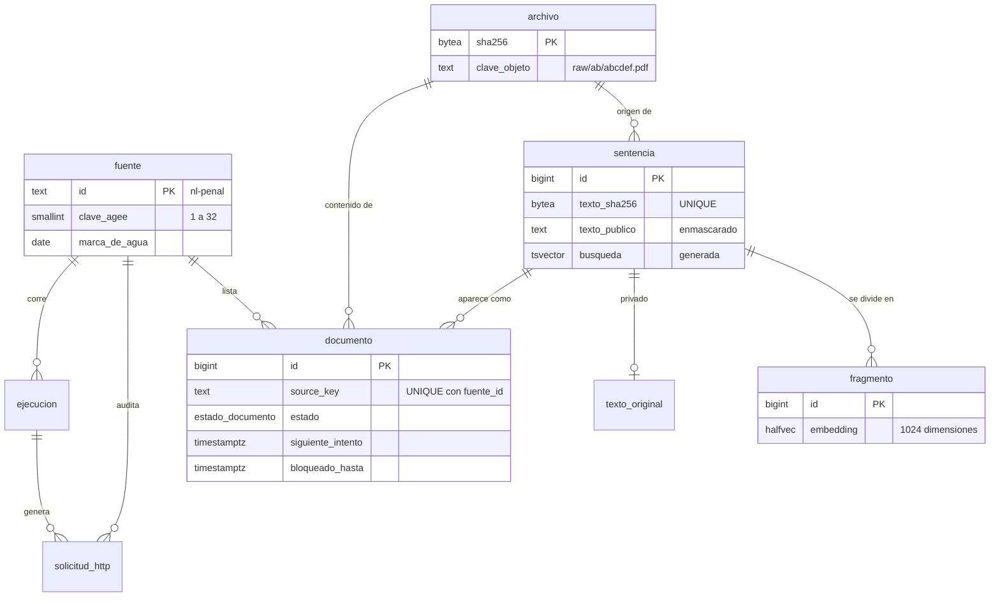

# 02 · Esquema de base de datos

Este documento explica el esquema de PostgreSQL del pipeline. Es el **Bloque 2** de 5.

El SQL vive en dos migraciones:

| Archivo | Contenido | Requisitos |
| :--- | :--- | :--- |
| `sql/001_esquema_inicial.sql` | Tablas, cola de trabajo, búsqueda por palabras, roles | PostgreSQL 16+, `unaccent`, `pg_trgm` |
| `sql/002_busqueda_semantica.sql` | Fragmentos con embeddings | pgvector 0.7+ (por el tipo `halfvec`) |

La búsqueda semántica va aparte porque pgvector puede faltar en algunos ambientes. Sin `002`, todo lo demás funciona.

---

## 1. Diagrama entidad-relación



---

## 2. Qué guarda cada tabla

| Tabla | Una fila por… | Para qué sirve |
| :--- | :--- | :--- |
| `fuente` | Adaptador (portal + materia) | Configuración de cortesía y marca de agua. |
| `ejecucion` | Corrida de una etapa | Su `id` es el `run_id` de los logs. |
| `solicitud_http` | Solicitud a un portal | Auditoría de la cosecha responsable. |
| `documento` | Aparición en un listado | Ciclo de vida y **cola de trabajo**. |
| `archivo` | Contenido binario único | Deduplicación nivel 2. |
| `sentencia` | Texto único | Metadatos, texto enmascarado y búsqueda. Deduplicación nivel 3. |
| `privado.texto_original` | Sentencia | Texto sin enmascarar, solo para reprocesar. |
| `fragmento` | Trozo de una sentencia | Búsqueda semántica. |

---

## 3. Cómo se aplican las decisiones del Bloque 1

### 3.1 Deduplicación en tres niveles

| Nivel | Restricción en SQL |
| :--- | :--- |
| 1 | `UNIQUE (fuente_id, source_key)` en `documento`. El código usa `INSERT … ON CONFLICT DO NOTHING`. |
| 2 | `archivo.sha256` es la llave primaria. |
| 3 | `UNIQUE (texto_sha256)` en `sentencia`. |

Varios `documento` pueden apuntar al mismo `archivo` o a la misma `sentencia`. Así se conservan todos los alias sin duplicar contenido.

### 3.2 Cola de trabajo sin Redis

La tabla `documento` también es la cola. Un worker pide trabajo así:

```sql
SELECT * FROM justicia.tomar_documentos('descubierta', 10);
```

1. `FOR UPDATE SKIP LOCKED` evita que dos workers tomen el mismo documento.
2. `bloqueado_hasta` es un *lease* de 15 minutos. Si el worker muere, el documento vuelve a la cola.
3. `siguiente_intento` permite programar reintentos con backoff.
4. Un índice parcial solo incluye estados pendientes, así que se mantiene pequeño.

### 3.3 Búsqueda por palabras

- La configuración `justicia.es_unaccent` combina `unaccent` con el stemmer de español. "violéncia", "VIOLENCIA" y "violencias" coinciden.
- La columna `busqueda` se genera sola. Pesos: expediente y delitos (A), sentido y descripción (B), texto completo (D).
- Un índice de trigramas en `juez` tolera diferencias de acentos y errores de captura.

### 3.4 Datos personales

- La API solo ve `texto_publico`, que ya está enmascarado.
- El texto original está en el esquema `privado`.
- El rol `justicia_lectura` (API) no tiene acceso a `privado` ni a la auditoría HTTP.
- El rol `justicia_pipeline` escribe en ambos esquemas.

### 3.5 Reproducibilidad

`sentencia` guarda `extractor_version` y `metadatos_version`. Para reprocesar tras un cambio de reglas, basta con buscar las versiones viejas.

---

## 4. Cómo se probó

Las migraciones se aplicaron en PostgreSQL 16 local. Se verificó:

1. Un `source_key` repetido no crea otro documento.
2. Dos workers seguidos reciben documentos distintos y un tercero no recibe nada.
3. La búsqueda ignora acentos y mayúsculas, y los trigramas encuentran al juez sin acentos.
4. Las restricciones rechazan: `clave_agee` fuera de 1–32, un documento `descargada` sin archivo y un documento `indexada` sin sentencia.
5. `justicia_lectura` lee `sentencia` pero no `privado` ni `solicitud_http`.

**Pendiente:** el entorno de prueba solo tenía pgvector 0.6, que no incluye `halfvec`. La migración `002` se probó cambiando `halfvec` por `vector`. Hay que probarla con la imagen `pgvector/pgvector:pg17` del Bloque 4.

---

## 5. Fuera de este bloque

- **Herramienta de migraciones** (por ejemplo, Alembic): se decide en el Bloque 4.
- **Particiones de `solicitud_http`** por mes: se evalúa en el Bloque 5, cuando crezca la tabla.
