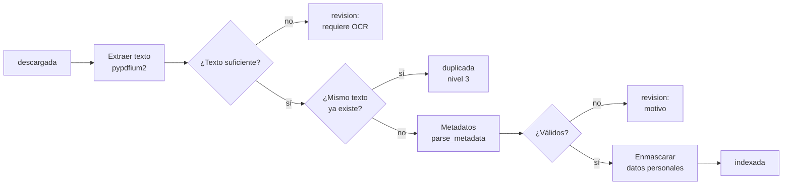

# 03b · Procesamiento: texto, metadatos y enmascaramiento

Segunda parte del **Bloque 3**. Cubre la etapa 3 del pipeline: de un PDF descargado a una sentencia indexada.

---

## 1. Cómo correrlo

```bash
pip install -e '.[nlp]'                        # incluye spaCy y su modelo en español
justicia procesar nl-penal --limite 20         # documentos 'descargada'
justicia procesar nl-penal --revision          # reintenta los que están en 'revision'
```

---

## 2. Qué pasa con cada documento



| Módulo | Responsabilidad |
| :--- | :--- |
| `processing/extract.py` | Texto del PDF y normalización (Unicode, guiones de corte, espacios). |
| `processing/metadata.py` | Estructura `Metadatos`, reglas comunes y validación. |
| `adapters/nuevo_leon.py` → `parse_metadata` | Reglas propias del portal de Nuevo León. |
| `processing/pii.py` | Enmascaramiento de datos personales. |
| `flows/procesamiento.py` | Etapa `procesar`. |

**Validación.** Una sentencia va a `revision` si le falta fecha de emisión, sentido del fallo o delitos (en materia penal), o si el texto es muy corto. El motivo queda en `documento.ultimo_error`.

**Versiones.** Cada sentencia guarda `extractor_version`, `metadatos_version` y la versión del enmascaramiento. Así se sabe qué reprocesar cuando cambia una regla.

---

## 3. Metadatos de Nuevo León

| Campo | Fuente |
| :--- | :--- |
| Delitos, juez, sentido, descripción, fechas | Fila del listado (todas las filas del registro) |
| Sentido del fallo, si el listado viene vacío | Texto: "se condenó", "se absuelve", … |
| Código del documento (`CO000036718320`) | Encabezado del PDF |
| Tipo de resolución y procedimiento (abreviado / juicio oral) | Encabezado del PDF |
| Municipio | Primera línea del PDF |
| Expediente | Texto, solo si no viene testado (casi siempre lo está) |

---

## 4. Enmascaramiento de datos personales

### Por qué es necesario

En los 20 PDF reales, **el testado del tribunal está incompleto**. Hay nombres completos de particulares sin tapar. Nuestra capa propia es indispensable antes de publicar el texto.

### Cinco capas

1. **Patrones fijos:** CURP, RFC, correos, teléfonos (10 dígitos) y domicilios (calle, avenida, colonia… seguidos de mayúscula o número).
2. **Modelo spaCy** `es_core_news_md`: detecta nombres de persona. No reconoce nombres en MAYÚSCULAS, así que esas secuencias se pasan a formato título antes de analizarlas.
3. **Nombre pegado a un testado parcial:** "José **********".
4. **Propagación:** un nombre detectado una vez se tapa en todo el documento.
5. **Nombres de pila frecuentes** seguidos de palabras con mayúscula inicial, para lo que el modelo omite.

**Criterio conservador:** se tapan todas las personas, salvo el juez de la sentencia. Es preferible tapar de más que publicar a un particular.

### Resultado con los 20 PDF reales

| Medida | Valor |
| :--- | :--- |
| Elementos tapados | ~2,000 nombres, ~160 domicilios |
| Falsos positivos corregidos | 60 "teléfonos" que eran registros de jurisprudencia; ~280 "domicilios" que eran "privada de la libertad" |
| Nombres que siguen visibles (revisión con lista de nombres de pila) | 2 fragmentos sueltos en 20 documentos |
| Tiempo | ~1.5 s por sentencia |

**Ninguna capa automática es perfecta.** Es una protección adicional, no una garantía.

---

## 5. Resultado de la corrida real

| Resultado | Cantidad |
| :--- | :--- |
| Indexadas | 19 (514 páginas) |
| En revisión | 1 (registro 489195: sin delitos en el listado y PDF con otro formato) |
| Errores | 0 |
| Condenas / absoluciones / otras | 15 / 3 / 1 |
| Procedimientos abreviados | 8 |

La búsqueda `feminicidio perspectiva de genero` (sin acento) encuentra la sentencia de feminicidio calificado y resalta el fragmento.

---

## 6. Pendientes y decisiones abiertas

- **Licencia del modelo:** `es_core_news_md` es **GPL-3.0** (por sus datos de entrenamiento, AnCora). spaCy es MIT. Hay que validar con el ITAM, igual que se hizo con PyMuPDF (AGPL) en el Bloque 1.
- **Testado incompleto del tribunal:** conviene decidir si el proyecto lo reporta al Poder Judicial de Nuevo León.
- **OCR:** los documentos sin texto quedan en `revision`. OCRmyPDF se agrega con la imagen Docker del Bloque 4.
- **Embeddings:** la tabla `fragmento` (migración 002) se llena en el Bloque 4, cuando haya pgvector 0.7+.
- **Revisión humana:** falta una muestra revisada a mano para medir cuántos nombres se escapan.
